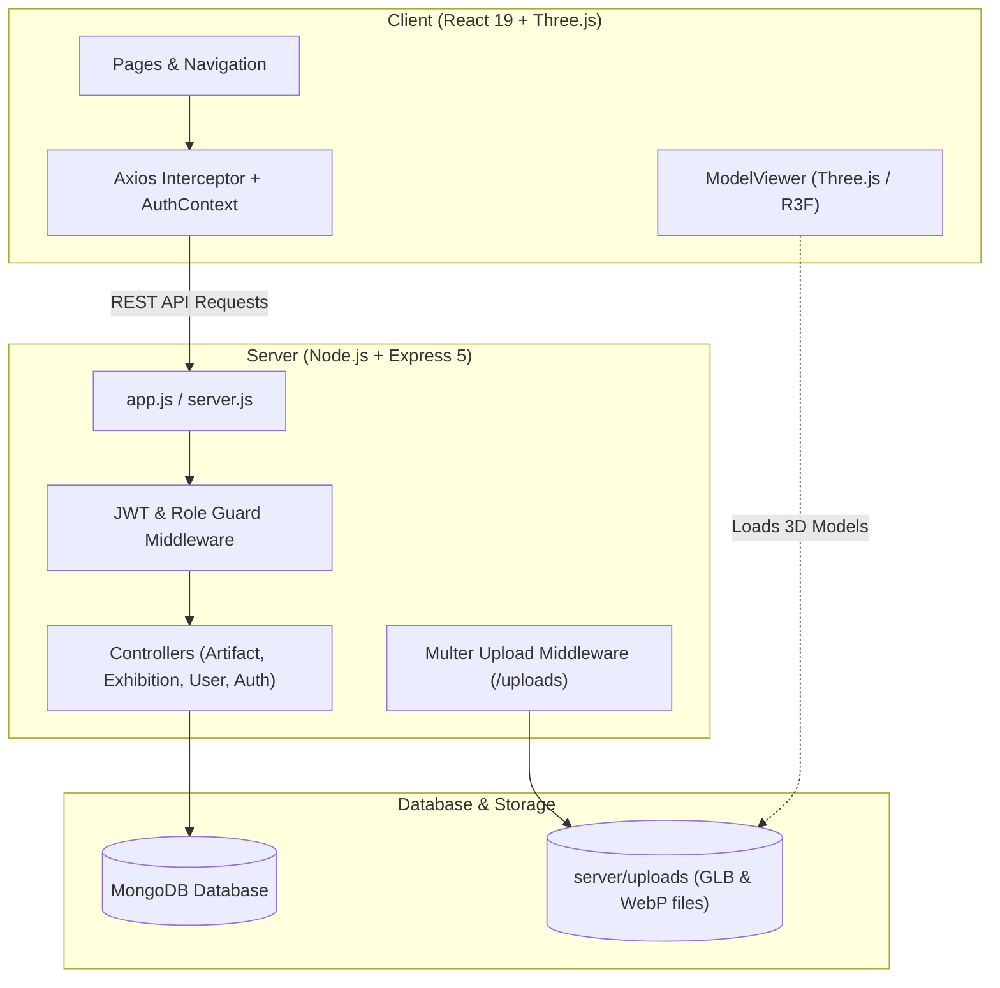

# Beyond the Glass - Complete Architecture & Codebase Guide

This document provides a comprehensive, file-by-file and folder-by-folder explanation of the entire **Beyond the Glass** project. It outlines the purpose of each file and folder, where and how it is used, its role in the overall architecture, and key technical details.

---

## Table of Contents
1. [Project Overview & Architecture](#project-overview--architecture)
2. [Root Workspace Files & Folders](#1-root-workspace-files--folders)
   - [Scripts Directory (`scripts/`)](#scripts-directory-scripts)
   - [Documentation (`docs/`)](#documentation-docs)
   - [Raw 3D Models (`raw-models/`)](#raw-3d-models-raw-models)
3. [Backend Server (`server/`)](#2-backend-server-server)
   - [Server Entry & Setup](#server-entry--setup)
   - [Configuration (`server/config/`)](#database-configuration-serverconfig)
   - [Database Models (`server/models/`)](#database-models-servermodels)
   - [Controllers (`server/controllers/`)](#controllers-servercontrollers)
   - [Routes (`server/routes/`)](#routes-serverroutes)
   - [Middleware (`server/middleware/`)](#middleware-servermiddleware)
   - [Utilities (`server/utils/`)](#utilities-serverutils)
   - [Database Scripts (`server/scripts/`)](#database-scripts-serverscripts)
   - [Uploaded Files (`server/uploads/`)](#uploaded-files-serveruploads)
4. [Frontend Client (`client/`)](#3-frontend-client-client)
   - [Client Root & Build Configuration](#client-root--build-configuration)
   - [Public Assets (`client/public/`)](#public-assets-clientpublic)
   - [Client Core Setup (`client/src/`)](#client-core-setup-clientsrc)
   - [API & Global Context](#api--global-context)
   - [Custom React Hooks (`client/src/hooks/`)](#custom-react-hooks-clientsrchooks)
   - [Client Utilities (`client/src/utils/`)](#client-utilities-clientsrcutils)
   - [Shared UI Components (`client/src/components/`)](#shared-ui-components-clientsrccomponents)
   - [Curator Dashboard Components (`client/src/components/dashboard/`)](#curator-dashboard-components-clientsrccomponentsdashboard)
   - [3D Interactive Engine (`client/src/components/viewer/`)](#3d-interactive-engine-clientsrccomponentsviewer)
   - [Public Pages (`client/src/pages/`)](#public-pages-clientsrcpages)
   - [Curator Dashboard Pages (`client/src/pages/dashboard/`)](#curator-dashboard-pages-clientsrcpagesdashboard)
5. [Summary Quick Reference Table](#4-summary-quick-reference-table)

---

## Project Overview & Architecture

**Beyond the Glass** is a modern Full-Stack 3D Digital Museum Web Application:
- **Frontend (`client/`)**: Built with **React 19**, **Vite**, **Tailwind CSS v4**, and **Three.js / React Three Fiber / @react-three/drei** for hardware-accelerated 3D WebGL rendering.
- **Backend (`server/`)**: Built with **Node.js**, **Express 5**, and **MongoDB / Mongoose 9** for authentication, role-based access control, file storage, and REST APIs.
- **Root Tooling**: Scripts and automated pipelines for 3D model compression (Draco / Meshopt) and headless thumbnail generation.

---

## 1. Root Workspace Files & Folders

### `package.json`
- **What it is**: The root project configuration and npm package manifest.
- **Purpose**: Allows running both client and server simultaneously using `concurrently`. Also defines CLI dependencies for 3D asset processing (`@gltf-transform/core`, `three`, `sharp`, `puppeteer`).
- **Key Scripts**:
  - `npm run dev`: Runs server (`port 5000`) and client (`port 5173`) concurrently.
  - `npm run optimize`: Compresses raw 3D models with Draco/Meshopt.
  - `npm run thumbnails`: Automatically captures `.webp` previews for 3D `.glb` files.

### `render.yaml`
- **What it is**: Blueprint deployment configuration for Render cloud hosting.
- **Purpose**: Defines automated deployment instructions for the Express backend web service and environment variables (MongoDB URI, JWT secret, Cloudinary credentials).

### `.gitignore`
- **What it is**: Git exclusions file.
- **Purpose**: Prevents `node_modules/`, local `.env` secrets, build folders (`dist/`), OS metadata, and transient cache files from being tracked in version control.

### `README.md`
- **What it is**: Project overview and documentation.
- **Purpose**: Describes features, prerequisites, setup instructions, environment variables, and REST API endpoint specifications.

### `CLAUDE.md`
- **What it is**: Development guidelines and developer quick reference.
- **Purpose**: Outlines port configurations, monorepo structure, coding patterns, and conventions used across the project.

### `raw-models/`
- **What it is**: Folder holding source, uncompressed 3D models in `.glb` format.
- **Where it is used**: Read by `scripts/optimize-models.js` before compressing and outputting production-ready files into `server/uploads/models/`.

### `scripts/` (Build & Asset Automation)
- **`scripts/optimize-models.js`**: Node.js optimization pipeline using `@gltf-transform`. It processes raw 3D models, applies Draco geometry compression, cleans up vertex attributes, compresses textures, and reduces file sizes for high-performance web streaming.
- **`scripts/generate-thumbnails.js`**: Headless browser automation script using Puppeteer. Launches `thumbnail-viewer.html`, loads 3D models, captures canvas frames, and encodes WebP preview images via `sharp`.
- **`scripts/thumbnail-viewer.html`**: Minimal standalone HTML file with Three.js used exclusively by `generate-thumbnails.js` to render the model scene offscreen.

### `docs/`
- **`docs/api-test-plan.md`**: Manual test cases and cURL commands for verifying authentication, artifact CRUD operations, and user favorites endpoints.
- **`docs/screenshots/`**: Screenshot gallery (`home.jpg`, `artifact.jpg`, `discover.jpg`, etc.) demonstrating the user interface for documentation and presentations.

---

## 2. Backend Server (`server/`)

The backend is built with Express 5 and MongoDB. It handles authentication, database persistence, role checks, and file delivery.

### Server Entry & Setup
- **`server/server.js`**: The application entry point. It establishes the database connection via `connectDB()`, reads `process.env.PORT` (default 5000), starts the HTTP listener, and handles graceful shutdown on `SIGINT`/`SIGTERM`.
- **`server/app.js`**: Configures the Express app instance:
  - Security headers via `helmet`
  - CORS with credentials support
  - JSON body parsing (`express.json({ limit: '10mb' })`)
  - Static file delivery for `/uploads` pointing to `server/uploads`
  - Mounts all API route groups (`/api/auth`, `/api/artifacts`, `/api/exhibitions`, `/api/users`, `/api/health`)
  - Central 404 handler and global error handler.
- **`server/package.json`**: Backend dependencies (`express`, `mongoose`, `jsonwebtoken`, `bcryptjs`, `multer`, `cloudinary`, `dotenv`, `cors`, `helmet`, `express-rate-limit`).
- **`server/.env.example`**: Template for backend environment variables (`MONGO_URI`, `PORT`, `JWT_SECRET`, `CLIENT_ORIGIN`, `STORAGE_DRIVER`).

### Database Configuration (`server/config/`)
- **`server/config/db.js`**: Connects to MongoDB via `mongoose.connect()`. Logs connection state and handles termination events cleanly.

### Database Models (`server/models/`)
- **`server/models/User.js`**:
  - Schema for user accounts.
  - Fields: `name`, `email` (unique), `password` (hashed with bcrypt), `role` (`'visitor'` or `'curator'`), and `favorites` (array of `ObjectId` references to `Artifact`).
  - Methods: `comparePassword(candidatePassword)` using bcrypt.
- **`server/models/Artifact.js`**:
  - Schema representing 3D museum pieces.
  - Fields: `title`, `slug` (unique URL-safe identifier), `description`, `category` (Sculpture, Weapon, Tool, Pottery, Jewelry, Space, Other), `era`, `origin`, `material`, `dimensions`, `dating`, `modelUrl` (path to `.glb`), `modelFormat`, `thumbnailUrl`, `credits` (author, license, sourceUrl), `isPublished`, `featured`, `curator` (`ObjectId` reference to User).
  - Indexes: Full-text search index on `title`, `description`, `origin`, `material`, `era`.
- **`server/models/Exhibition.js`**:
  - Schema for curated thematic collections.
  - Fields: `title`, `slug`, `description`, `coverImage`, `isPublished`, `curator`, and `artifacts` (ordered array of `ObjectId` references to Artifact).

### Controllers (`server/controllers/`)
- **`server/controllers/authController.js`**: Handles `register`, `login`, and `getMe` (retrieves current authenticated profile from JWT).
- **`server/controllers/artifactController.js`**:
  - `getArtifacts`: Public catalog query with text search, category/era filters, and pagination.
  - `getArtifactBySlug`: Fetches single item along with related items.
  - `getFeaturedArtifacts`: Fetches showcase artifacts for the homepage.
  - Curator actions: `createArtifact`, `updateArtifact`, `deleteArtifact`, `getCuratorArtifacts`.
  - Cleans up uploaded disk/Cloudinary files when models or thumbnails are updated or deleted.
- **`server/controllers/exhibitionController.js`**: Handles exhibition browsing and curator management (`getExhibitions`, `getExhibitionBySlug`, `createExhibition`, `updateExhibition`, `deleteExhibition`, `getCuratorExhibitions`).
- **`server/controllers/userController.js`**: Manages visitor favorites (`getFavorites`, `addFavorite`, `removeFavorite`).
- **`server/controllers/healthController.js`**: Returns API health status, server uptime, and MongoDB connectivity state for monitoring.

### Routes (`server/routes/`)
- **`server/routes/authRoutes.js`**:
  - `POST /api/auth/register` (rate-limited)
  - `POST /api/auth/login` (rate-limited)
  - `GET /api/auth/me` (requires `verifyToken`)
- **`server/routes/artifactRoutes.js`**:
  - `GET /api/artifacts`, `GET /api/artifacts/featured`, `GET /api/artifacts/mine`, `GET /api/artifacts/:slug`
  - `POST /api/artifacts`, `PUT /api/artifacts/:id`, `DELETE /api/artifacts/:id` (protected by `verifyToken`, `requireRole('curator')`, and `uploadArtifactFiles`).
- **`server/routes/exhibitionRoutes.js`**:
  - `GET /api/exhibitions`, `GET /api/exhibitions/mine`, `GET /api/exhibitions/:slug`
  - `POST /api/exhibitions`, `PUT /api/exhibitions/:id`, `DELETE /api/exhibitions/:id`.
- **`server/routes/userRoutes.js`**:
  - `GET /api/users/favorites`, `POST /api/users/favorites/:artifactId`, `DELETE /api/users/favorites/:artifactId`.
- **`server/routes/healthRoutes.js`**:
  - `GET /api/health`

### Middleware (`server/middleware/`)
- **`server/middleware/verifyToken.js`**: Extracts and validates Bearer JWT tokens from the `Authorization` header, attaching `req.user` (`{ id, role }`).
- **`server/middleware/requireRole.js`**: Role guard middleware (e.g. `requireRole('curator')`). Returns 403 Forbidden if user lacks the required role.
- **`server/middleware/optionalAuth.js`**: Non-blocking authentication check. Attaches user info if a valid JWT is present (allowing curators to preview unpublished drafts), while permitting unauthenticated visitors to proceed.
- **`server/middleware/upload.js`**: Multer configuration with MIME-type and size checks:
  - 3D models: accepts `.glb` files up to 50MB.
  - Images: accepts JPEG, PNG, WebP up to 5MB.
  - Supports local disk storage (`server/uploads/`) or Cloudinary based on `STORAGE_DRIVER`.
- **`server/middleware/validateObjectId.js`**: Intercepts requests with `:id` parameters and returns 400 Bad Request if the ID is not a valid 24-character hexadecimal MongoDB ObjectId.
- **`server/middleware/rateLimits.js`**: Uses `express-rate-limit` to prevent brute-force attacks on login and registration endpoints.
- **`server/middleware/errorHandler.js`**: Centralized Express error handler returning consistent JSON responses `{ success: false, error: "message" }`.

### Utilities (`server/utils/`)
- **`server/utils/generateToken.js`**: Signs JSON Web Tokens with user ID and role, expiring in 7 days.
- **`server/utils/slug.js`**: Transforms human titles into URL-safe slugs (e.g. `"Rosetta Stone"` $\to$ `"rosetta-stone"`), resolving collisions automatically.
- **`server/utils/validate.js`**: Validation helpers for email format, password complexity, and required input fields.
- **`server/utils/files.js`**: Safe file deletion helper that cleans up replaced or deleted `.glb` models and image files from local disk or Cloudinary.
- **`server/utils/httpError.js`**: Custom `HttpError` class attaching standard HTTP status codes (400, 401, 403, 404, 500) to error objects.
- **`server/utils/exhibitionLinks.js`**: Generates navigation links and breadcrumb data for exhibitions.

### Database Scripts (`server/scripts/`)
- **`server/scripts/seed.js`**: Database initialization script (`node server/scripts/seed.js`). Clears and seeds default users (curator@beyondtheglass.org, visitor@beyondtheglass.org), museum artifacts, and exhibitions.
- **`server/scripts/seed-data.json`**: Static JSON dataset used by `seed.js` containing initial museum artifacts and default user records.
- **`server/scripts/setRole.js`**: Administrative CLI utility to promote or demote any user: `node server/scripts/setRole.js user@example.com curator`.

### Uploaded Files (`server/uploads/`)
- **`server/uploads/models/`**: Storage directory for static 3D `.glb` binary assets, served to the browser via `/uploads/models/...`.
- **`server/uploads/thumbnails/`**: Storage directory for `.webp` preview images of 3D models, served via `/uploads/thumbnails/...`.

---

## 3. Frontend Client (`client/`)

The client is a single-page application (SPA) created with React 19 and Vite.

### Client Root & Build Configuration
- **`client/index.html`**: Entry HTML template. Loads Google Fonts (*Bodoni Moda* serif for headings, *Hanken Grotesk* for UI body text) and mounts `
`.
- **`client/vite.config.js`**: Vite configuration file. Enables `@vitejs/plugin-react`, `@tailwindcss/vite`, path aliases (`@` $\to$ `src`), and local dev proxy forwarding `/api` and `/uploads` requests to `http://localhost:5000`.
- **`client/package.json`**: Client dependencies (`react`, `react-dom`, `react-router-dom`, `three`, `@react-three/fiber`, `@react-three/drei`, `lucide-react`, `axios`, `clsx`, `tailwind-merge`).
- **`client/vercel.json`**: SPA rewrite rule (`"source": "/(.*)", "destination": "/index.html"`) enabling client-side routing on Vercel deployments.
- **`client/.env.example`**: Template for frontend environment variables (`VITE_API_URL`).

### Public Assets (`client/public/`)
- **`client/public/favicon.svg`**: Museum vitrine browser tab icon.
- **`client/public/draco/`**:
  - `draco_decoder.js`, `draco_decoder.wasm`, `draco_wasm_wrapper.js`: Google Draco WebAssembly decompression engine used in worker threads to decompress compressed 3D geometry in the browser.

### Client Core Setup (`client/src/`)
- **`client/src/main.jsx`**: React entry point mounting the app with `StrictMode`, `BrowserRouter`, and the global `AuthProvider`.
- **`client/src/App.jsx`**: Root routing setup using `React.lazy` code splitting and `<Suspense>`:
  - Public routes: `/` (HomePage), `/discover` (DiscoverPage), `/artifacts/:slug` (ArtifactPage), `/login`, `/register`.
  - Protected visitor route: `/collection` (CollectionPage).
  - Protected curator routes: `/dashboard`, `/dashboard/artifacts/new`, `/dashboard/artifacts/:id/edit`, `/dashboard/exhibitions/new`, `/dashboard/exhibitions/:id/edit`.
- **`client/src/index.css`**: Tailwind CSS v4 design tokens and custom utility classes:
  - Museum obsidian palette (`--color-canvas: #0c0d0e`, `--color-surface: #141619`)
  - Warm gold accents (`--color-gold: #c6a25e`, `--color-gold-glow: #e0be7a`)
  - Typography bindings, glassmorphism blur effects, and custom scrollbars.

### API & Global Context
- **`client/src/api/axios.js`**:
  - Centralized Axios client configured with base URL (`/api`).
  - **Request Interceptor**: Reads JWT token from `localStorage` (`btg_token`) and automatically attaches `Authorization: Bearer <token>`.
  - **`fileUrl(path)`**: Helper function that ensures asset paths (like `/uploads/...` or external URLs) resolve to valid absolute URLs for 3D loaders and images.
- **`client/src/context/AuthContext.jsx`**:
  - Global authentication provider supplying `user`, `login(email, password)`, `register(name, email, password)`, `logout()`, `isCurator`, `isAuthenticated`, and `favorites` array state.
  - Verifies saved tokens on initial page load via `/api/auth/me`.

### Custom React Hooks (`client/src/hooks/`)
- **`client/src/hooks/useAuth.js`**: Convenient hook providing access to `AuthContext` state from any component.
- **`client/src/hooks/useApi.js`**: Generalized asynchronous fetch hook returning `{ data, loading, error, execute }` for clean API handling.
- **`client/src/hooks/useDebouncedValue.js`**: Delays search query state updates (e.g. 300ms) to prevent unnecessary API requests while typing in search bars.
- **`client/src/hooks/useDocumentTitle.js`**: Dynamically updates the browser tab title (e.g. `"Rosetta Stone | Beyond the Glass"`).
- **`client/src/hooks/useObjectUrl.js`**: Creates and automatically revokes temporary `blob:` URLs when curators select local files for preview before uploading.

### Client Utilities (`client/src/utils/`)
- **`client/src/utils/fileChecks.js`**: Client-side validation ensuring uploaded models are `.glb` files under 50MB and images are under 5MB before upload.

### Shared UI Components (`client/src/components/`)
- **`client/src/components/Navbar.jsx`**: Top navigation header with site branding, Discover link, My Collection link, Curator Dashboard link (for curators), and User Profile / Logout menu.
- **`client/src/components/Footer.jsx`**: Site footer with museum credits, navigation links, and copyright statement.
- **`client/src/components/Layout.jsx`**: Wrapper establishing standard page layout (`Navbar` + content + `Footer`).
- **`client/src/components/Logo.jsx`**: Reusable SVG brand mark and museum typography.
- **`client/src/components/ArtifactCard.jsx`**: Museum display card showing artifact thumbnail, title, era, category badge, and interactive favorite button.
- **`client/src/components/Vitrine.jsx`**: Glass display case wrapper with subtle lighting glow and border framing for showcase components.
- **`client/src/components/FavoriteButton.jsx`**: Heart icon button to toggle artifacts in and out of the user's saved collection with instant optimistic UI update.
- **`client/src/components/PageHeader.jsx`**: Standardized header banner for catalog pages with title, subtitle, and breadcrumb links.
- **`client/src/components/PageLoader.jsx`**: Full-page loading spinner displayed during route transitions.
- **`client/src/components/Pagination.jsx`**: Page selector component for paginated catalog results.
- **`client/src/components/EmptyState.jsx`**: Illustrated placeholder displayed when no search results or favorites are found.
- **`client/src/components/FormField.jsx`**: Reusable input/textarea wrapper with label, error message, and styling.
- **`client/src/components/ProtectedRoute.jsx`**: Route guard redirecting unauthenticated visitors to `/login`, and non-curators away from `/dashboard`.
- **`client/src/components/Skeletons.jsx`**: Shimmering placeholder skeletons displayed while loading artifact cards and model details.

### Curator Dashboard Components (`client/src/components/dashboard/`)
- **`client/src/components/dashboard/PublishSwitch.jsx`**: Toggle switch for draft vs. public status.
- **`client/src/components/dashboard/SortableList.jsx`**: Reorderable list for arranging artifacts inside an exhibition.
- **`client/src/components/dashboard/UploadProgress.jsx`**: Animated progress bar for large 3D file uploads.
- **`client/src/components/dashboard/Notice.jsx`**: Dismissible banner for success/warning/error feedback messages.

### 3D Interactive Engine (`client/src/components/viewer/`)
The core 3D viewing engine powered by **Three.js** and **React Three Fiber**:
- **`client/src/components/viewer/ModelViewer.jsx`**:
  - The main 3D viewport component. Mounts R3F `<Canvas>` with OrbitControls for mouse/touch rotation, zoom, and pan. Includes interaction hints ("Click & drag to rotate • Scroll to zoom").
- **`client/src/components/viewer/Model.jsx`**:
  - Loads the 3D `.glb` model using `@react-three/drei`'s `useGLTF`.
  - Configures Draco decoder to decompress compressed geometry.
  - Automatically computes bounding boxes to center and normalize any 3D model regardless of its original coordinates, and casts contact shadows beneath it.
- **`client/src/components/viewer/Lighting.jsx`**:
  - Multi-light museum studio rig: key light, soft fill light, subtle rim backlight, ambient light, and an environment map reflection preset for realistic materials and metallic sheens.
- **`client/src/components/viewer/FitCamera.jsx`**:
  - Calculates the 3D model's sphere/box dimensions and positions the camera at the exact distance required to frame the object without clipping.
- **`client/src/components/viewer/Loader.jsx`**:
  - Elegant loading screen showing progress percentage while the 3D model downloads into memory.
- **`client/src/components/viewer/ViewerErrorBoundary.jsx`**:
  - React error boundary catching WebGL or parsing failures and displaying a graceful fallback message instead of crashing the page.
- **`client/src/components/viewer/ViewerMessage.jsx`**:
  - Overlay component for displaying errors (e.g. "Model file not found") inside the 3D canvas container.
- **`client/src/components/viewer/lightingPresets.js`**:
  - Lighting configurations (intensities, colors, positions) tailored for museum rendering.
- **`client/src/components/viewer/preloadModel.js`**:
  - Preloader utility triggering background fetching of 3D models before the user clicks on them.
- **`client/src/components/viewer/viewerSettings.js`**:
  - Default configuration parameters for OrbitControls (damping, zoom limits, min/max polar angles).

### Public Pages (`client/src/pages/`)
- **`client/src/pages/HomePage.jsx`**:
  - Museum landing page. Features a hero banner with call-to-actions, an interactive showcase vitrine, and a grid of curated featured artifacts.
- **`client/src/pages/DiscoverPage.jsx`**:
  - The museum artifact catalog. Provides debounced keyword search, category filter chips (Sculpture, Weapon, Tool, etc.), sorting options, and paginated artifact cards.
- **`client/src/pages/ArtifactPage.jsx`**:
  - The detailed artifact view. Embeds the full 3D interactive `ModelViewer`, metadata panel (era, origin, material, dimensions, dating), historical narrative, attribution credits, and related items.
- **`client/src/pages/CollectionPage.jsx`**:
  - "My Collection" page for logged-in visitors. Displays all artifacts they have favorited with one-click unfavorite and direct links back into the 3D viewer.
- **`client/src/pages/LoginPage.jsx`**:
  - Authentication page for existing visitors and curators to log in.
- **`client/src/pages/RegisterPage.jsx`**:
  - Account creation page with validation.
- **`client/src/pages/NotFoundPage.jsx`**:
  - 404 error page displayed when visiting non-existent routes with a button to return home.

### Curator Dashboard Pages (`client/src/pages/dashboard/`)
- **`client/src/pages/dashboard/DashboardPage.jsx`**:
  - Main curator portal with statistics (total artifacts, published count, exhibitions) and tabbed views for managing artifacts and exhibitions.
- **`client/src/pages/dashboard/ArtifactsTable.jsx`**:
  - Data table of curator's artifacts with status badges (Draft/Published), quick search, thumbnail previews, edit buttons, and deletion confirmation modals.
- **`client/src/pages/dashboard/ArtifactForm.jsx`**:
  - Comprehensive form to create or edit an artifact. Handles 3D `.glb` file selection, thumbnail uploads, metadata inputs (origin, material, dimensions, era), attribution fields, and publication toggling.
- **`client/src/pages/dashboard/ExhibitionsList.jsx`**:
  - Management list for curator exhibitions.
- **`client/src/pages/dashboard/ExhibitionForm.jsx`**:
  - Form to create and edit curated exhibitions, attach cover photos, and select which artifacts belong to that exhibition.

---

## 4. Summary Quick Reference Table

| Folder / Layer | Primary Technologies | Core Responsibility |
| :--- | :--- | :--- |
| **Root Workspace** | Concurrently, Puppeteer, Three.js, Sharp | Orchestrates running frontend & backend; contains offline 3D model compression and thumbnailing tools. |
| **`server/models`** | Mongoose, MongoDB | Data schemas for Users, Artifacts, and Exhibitions. |
| **`server/controllers`** | Express, Mongoose | Business logic for authentication, catalog search, curator operations, and favorites. |
| **`server/routes`** | Express Router | REST API endpoint routing. |
| **`server/middleware`** | JWT, Multer, Helmet, Rate-Limit | Authentication token verification, role permissions, file upload filtering, and error handling. |
| **`server/uploads`** | Static File Storage | Local storage for uploaded 3D `.glb` assets and `.webp` thumbnails. |
| **`client/src/context`** | React Context API | Global authentication state and visitor favorites persistence. |
| **`client/src/components/viewer`** | Three.js, React Three Fiber, Drei | WebGL 3D rendering engine, OrbitControls camera handling, studio lighting, and Draco decompression. |
| **`client/src/pages`** | React, React Router | Visitor-facing views: Home, Catalog Discover, 3D Artifact Viewer, and Saved Collection. |
| **`client/src/pages/dashboard`** | React, Form Handlers | Curator administration: CRUD operations for 3D models, metadata forms, and exhibition management. |
